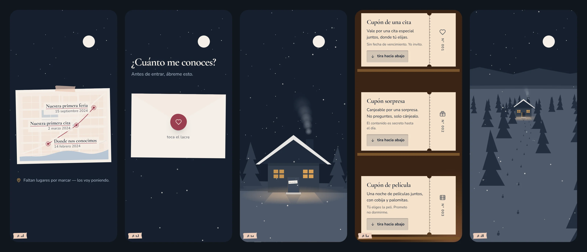

# Nuestra Historia

Un regalo de aniversario hecho como sitio web: un recorrido de arriba abajo, del atardecer a la noche, que se abre desde un link en el teléfono. Hay una trivia dentro de un sobre con lacre, boletos de papel que se rasgan, una cabaña con nieve y humo, y al final una carta.

Lo diseñé y programé de principio a fin. Esta es la **versión de muestra**: lleva textos de ejemplo y no incluye las fotos, los videos ni la canción de la versión real, que es personal y se queda privada. Las fotos que se ven son de ejemplo: el build las baja de [Lorem Picsum](https://picsum.photos) (imágenes de [Unsplash](https://unsplash.com)).



*De izquierda a derecha: el mapa de papel, el sobre con lacre de la trivia, la cabaña de noche, los boletos en su repisa y la caminata por la nieve.*

> **Demo en vivo:** https://nuestra-historia-muestra.scriptconcept.workers.dev/

**Stack:** React 19 · Vite 8 · Tailwind CSS v4 (solo para el reset y los tokens) · CSS y SVG a mano · sin librerías de animación.

## El recorrido

Cada tramo es una escena distinta; el scroll hace de cámara.

1. **Portada.** La foto a pantalla completa con el título por palabras, una nota pegada y una impresión que asoma abajo (con un video en bucle).
2. **La subida.** Un contador de días y los momentos como fotos impresas con cinta y notas de papel rasgado, más una mesa de fotos sueltas al final.
3. **El anochecer.** El cielo pasa del azul de la tarde a la noche con luna y estrellas.
4. **El mapa.** Una hoja de papel con un mapa dibujado; la ruta se descubre al subir.
5. **La puerta.** La trivia, dentro de un sobre que se abre al tocar el lacre.
6. **La cabaña.** La cámara se acerca a su puerta, la cruza, y el cuarto de adentro está encendido.
7. **Los boletos.** Cupones de cartón que hay que **arrancar** con un tirón, con su propia física.
8. **La salida y la travesía.** La cámara retrocede con perspectiva real mientras la cabaña se aleja y las huellas nacen de su puerta.
9. **La carta.** Se despliega al acercarse y cierra el recorrido.

Un casete flotante reproduce la canción y se aparta cuando haces scroll.

## Detalles técnicos de los que estoy contento

- **Un solo módulo de medición para todas las escenas** ([`src/nucleo/escena.js`](src/nucleo/escena.js)): un listener de scroll y un `requestAnimationFrame`, que escriben una variable CSS (`--p`) por escena. Casi toda la animación es CSS que lee esa variable; no hay estado de React por cuadro de scroll.
- **Perspectiva real, sin escalas "a ojo".** La travesía proyecta cada pino y cada huella con `y = horizonte + F / D`, `escala = S / D`, y escribe el `transform` solo si cambió.
- **El cielo se interpola en OKLCH** por el camino corto del matiz, porque en RGB pasaba por un gris sucio a media subida. Son siete colores base y todo lo demás es una mezcla de ellos.
- **Prerender + hidratación.** El build genera el HTML con `renderToString`, así que la página se lee sin JavaScript. Hay una red de seguridad: si el bundle no llega en 8 s, se quita la clase que esconde los elementos que se revelan, para que nada quede invisible.
- **El boleto se arranca de verdad.** Resistencia asintótica, un resorte con amortiguación crítica y un umbral de 72 px; el toque se decide al soltar. Vive en un módulo de unos 0.8 kB que solo se descarga cuando la habitación está a una pantalla.
- **`virtual:fotos`**: un plugin de Vite que mira qué fotos existen y cuánto miden (leyendo el encabezado del `.webp`). Lo que falta se pinta como un papel "aquí va una foto", sin 404 ni imagen rota; cada marco reserva su proporción antes de cargar, así que nada se mueve. En desarrollo detecta las fotos nuevas sin reiniciar.
- **Video con cuidado.** No se descarga hasta que la página terminó de cargar, solo corre mientras se ve, y se queda en su póster con "reducir movimiento" o con el ahorro de datos encendido. Se abre en grande con un `<dialog>` nativo.
- **La música respeta las políticas de autoplay**: intenta al primer scroll y, si el navegador la bloquea, espera al primer toque. El mp3 no se descarga hasta entonces.
- **Nieve en `<canvas>`** con viento en rachas, que solo corre mientras su escena está a la vista; con movimiento reducido se pinta una vez, quieta.
- **Nada falla por el almacenamiento.** Todo acceso a `localStorage` y `sessionStorage` pasa por un módulo con `try/catch`, y se lee después de hidratar.

## Accesibilidad y rendimiento

- Contraste AA medido **con píxeles** (se capturaba cada texto sobre su fondo real), objetivos táctiles de 44 px, `:hover` solo en dispositivos que lo tienen, contenido oculto con `inert`, galería y videos con `<dialog>` modal y `prefers-reduced-motion` respetado en todo lo que se mueve solo.
- El build actual pesa unos **89 kB de JavaScript y 13 kB de CSS** (gzip) y las únicas dependencias de ejecución son React y las fuentes, que van alojadas en el propio sitio.
- Durante el desarrollo lo medí en laboratorio con CPU ×4 y una red 4G lenta simulada: **LCP ≈ 2 s, CLS ≈ 0** y ninguna tarea larga al hacer scroll. Esas mediciones y la comprobación de contraste las hacía una suite propia de Playwright que no está en este repositorio.

## Probarlo en local

Hace falta Node (lo probé con Node 24).

```bash
npm install
npm run dev        # http://localhost:5173
npm run build      # genera dist/ con el HTML ya pintado
npm run preview    # sirve dist/ en http://localhost:8811
```

## Hacerlo tuyo

Todo lo que cambia está en [`src/data/`](src/data):

| Archivo | Qué contiene |
|---|---|
| `config.js` | Título, canción, fecha de inicio, textos de la trivia, carta final, lugares del mapa y el video de la portada |
| `historia.js` | Los momentos de la subida y las fotos extra |
| `trivia.js` | Las preguntas (la respuesta va ofuscada: `clave = posición × 7 + 3`) |
| `cupones.js` | Los boletos que se rasgan |

Las fotos van en `public/assets/fotos/` (`portada.webp`, `momento1.webp`, `extra1.webp`…) y la canción en `public/assets/audio/`. `npm run build` ejecuta antes `tools/muestras.js`, que baja fotos de ejemplo de Lorem Picsum para los nombres que falten; si pones las tuyas con esos nombres, se respetan. Si una foto no está y no hay red, el sitio muestra el papel en espera y sigue funcionando.

## Publicarlo

Es un sitio estático: `npm run build` y se sirve `dist/`. Con Cloudflare Workers (Workers Builds) basta conectar el repo con build `npm run build` y deploy `npx wrangler deploy`; `wrangler.jsonc` ya apunta a `dist/`.

## Estructura

```
src/
  components/   un componente por tramo (Portada, Subida, Mapa, Puerta, Umbral, Adentro…)
  nucleo/       escenas atadas al scroll, cielo, nieve, efectos, guardado, hooks
  logica/       trivia, cupones, arrastre del boleto, música (sin dibujo)
  data/         el contenido que se edita
  styles/       una hoja de estilos por tramo
tools/          muestras.js, prerender.js y servidor.js (los usa el build)
```

## Sobre esta versión

Proyecto personal publicado como muestra de portafolio. Los textos, los lugares y las fechas son de ejemplo.

Hecho por Alan · [@Alann-89](https://github.com/Alann-89)
